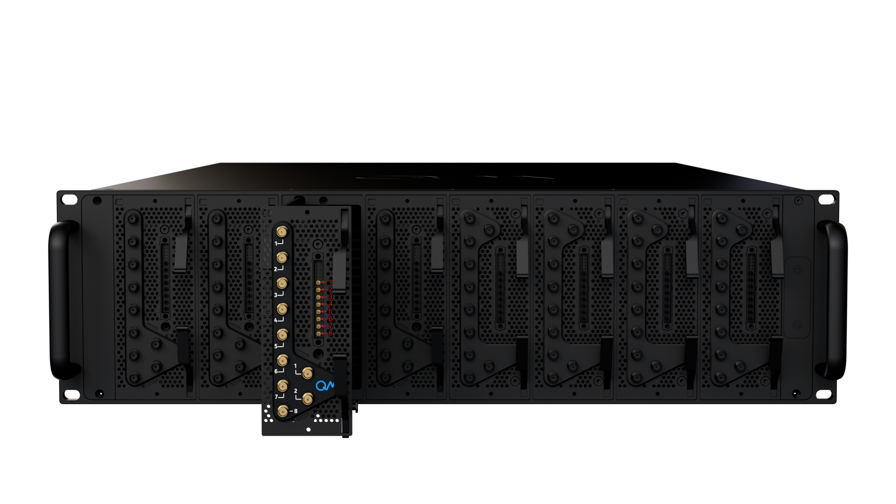
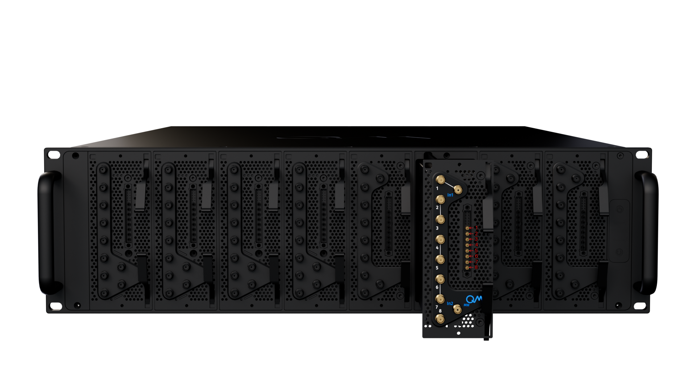
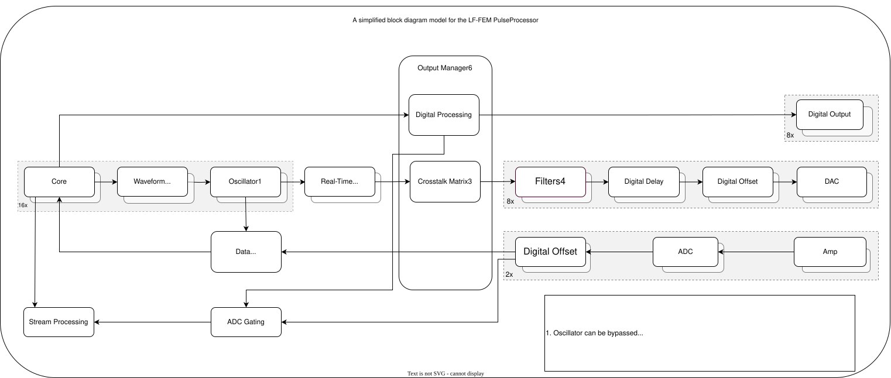
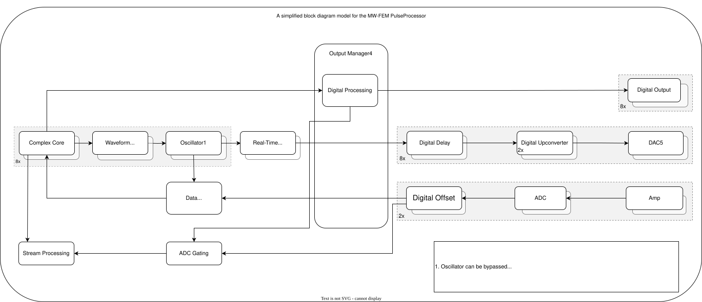
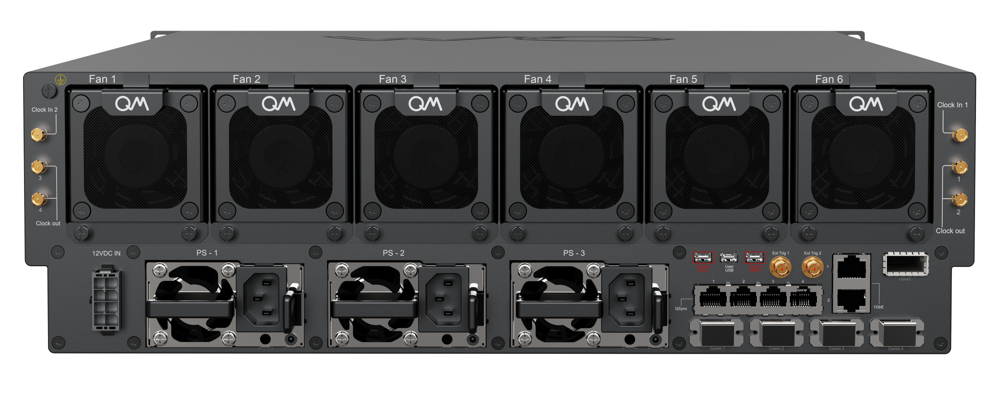

# OPX1000 Hardware Specifications

This page describes the hardware components of the OPX1000.

!!! Note
    This page includes a summary of key specifications. For complete technical details and full system specifications, refer to the full spec sheet.

    [Request the Full OPX1000 Spec Sheet](https://www.quantum-machines.co/request-the-full-opx1000-spec-sheet/)

## General Specifications

The table below groups the main general characteristics of the OPX1000.

{{ read_csv("docs/Hardware/assets/opx1000_hw_general_spec.csv") }}

## Port Specifications

The tables below groups the main characteristics of the LF-FEM & MW-FEM ports.

For more information, see [OPX1000 FEMs Guide](../Guides/opx1000_fems.md)

### LF-FEM



{{ read_csv("docs/Hardware/assets/lffem_panel_descr.csv") }}

{{ read_csv("docs/Hardware/assets/lffem_port_spec.csv") }}

!!! Note
    The `direct` mode is optimized for modulated signals and is designed to achieve high SFDR, but it results in an output impedance of 35 Ω.
    Despite being 35 Ω, the specification is given for a 50 Ω matched load.
    Connecting to a 50 Ω matched line will produce the exact applied output voltage without distortion, but connecting it to a High-Z load will not yield the expected doubling of the applied voltage at 50 Ω.

### MW-FEM



{{ read_csv("docs/Hardware/assets/mwfem_panel_descr.csv") }}

{{ read_csv("docs/Hardware/assets/mwfem_port_spec.csv") }}

## Pulse Processor Block Diagram

The simplified block diagram model for the Pulse Processor can be seen below.





## Setting the Input Gain

The voltage gain can be set by adding a `"gain_db"` field to the `"analog_inputs"` field
of the controller in the config.
The values it can take, in 1 dB granularity, are:

* LF-FEM: -3 to 29 dB
* MW-FEM: 0 to 32 dB

!!! Warning
    When the gain on the LF-FEM input is set to max attenuation, -3 dB, the maximal power that can be input to the ADC without significant distortion is 7 dBm.

    **Please avoid exceeding 4 dBm (0.5 V) on LF-FEM input & -10 dBm on MW-FEM input without attenuation. This may damage the controller.**

!!! Note
    In the LF-FEM, when changing the gain, the input DC offset needs to be recalibrated.


## Back Panel Description

The back panel of the OPX1000 is the interface for control, power and connectivity to other devices.
The following section details the back panel of the OPX1000 chassis.



{{ read_csv("docs/Hardware/assets/opx1000_back_panel_descr.csv") }}

!!! Note
    If the external trigger requires a low impedance port, its is advised to add a 50 $\Omega$ terminator to the line.
    See [Guide on External Triggering](../Guides/external_trigger.md) for more details regarding the usage of external triggering in the OPX.

## LED Indicators

### Boot Sequence

🟢 Chassis LED

* Blinks green when chassis is off
* Solid green when booting

🔵 FEM QM Logo - Solid blue once FEM boot begins


### Error Indications

🔴 Chassis Critical Error or Boot Failure

* Chassis LED turns solid red

🔴 Chassis Warning - Chassis LED blinks red at 0.5 Hz

* e.g.: missing fan, over‑voltage/current

### Update Indicators

🔄 QOP/Admin Update:

* Chassis LED blinks twice

🔄 BSP Update:

* Chassis LED flash twice every second during update.

    Upon completion, LED will be constant

## Controller Monitoring

You can query controller health data from Python through `qmm.get_devices()`. Each OPX1000 controller in the returned `controllers` mapping exposes temperature readings and resource-usage metrics.

### Temperatures

{{ requirement("QOP", "3.6") }} {{ requirement("QUA", "1.2.4") }}

```python
temperatures = qmm.get_devices().controllers["con1"].temperatures
```

`temperatures` is a dictionary of readings for the FEMs (1–8), the chassis, the chassis CPU, and the power supplies (CRPS 1–3). For thermal protection and airflow guidance, see [Temperature Management](temperature_management.md).

### Resource Usage Metrics

{{ requirement("QOP", "3.9") }} {{ requirement("QUA", "1.4.0") }}

```python
metrics = qmm.get_devices().controllers["con1"].metrics
print(metrics.cpu_utilization_percent, metrics.disk_available_gb)
```

`metrics` returns the latest resource-usage snapshot of the controller:

| Field | Description |
|-------|-------------|
| `cpu_utilization_percent` | CPU utilization of the whole controller, as a percentage of total CPU capacity (0–100). |
| `memory_available_gb` | Memory (RAM) available on the controller, in GiB. |
| `qop_cpu_percent` | Combined CPU utilization of the QOP services, as a percentage of total CPU capacity. |
| `qop_memory_percent` | Combined memory usage of the QOP services, as a percentage of total controller memory (RAM). |
| `disk_available_gb` | Free space on the controller's data partition, in GiB. |

All values are aggregates; no per-process or per-thread breakdown is provided.
If the connected QOP version does not support metrics, or metrics are not available for the controller, `metrics` returns `None` and a warning is logged.

---

[Request the Full OPX1000 Spec Sheet](https://www.quantum-machines.co/request-the-full-opx1000-spec-sheet/)
